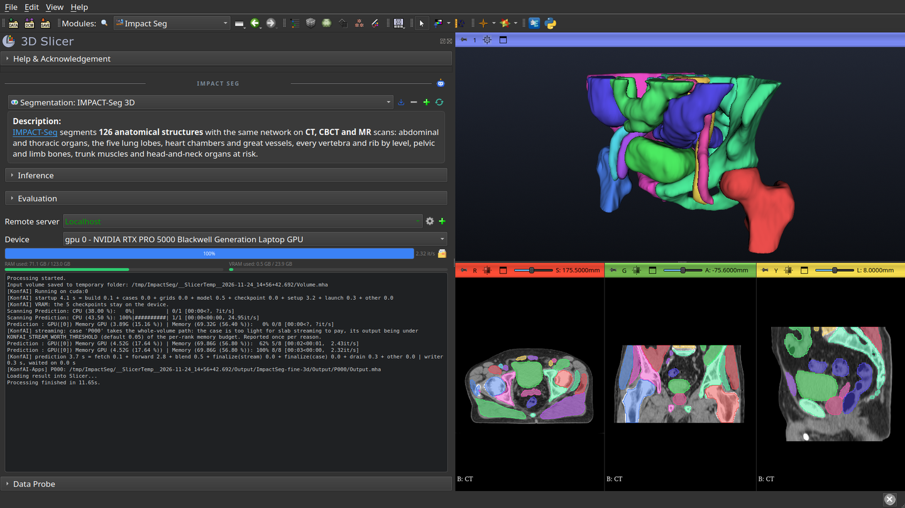

# 🧠 IMPACT-Seg: Anatomical segmentation of CT, CBCT and MRI in 3D Slicer

[](https://github.com/vboussot/SlicerImpactSeg/blob/main/LICENSE)
[](https://huggingface.co/VBoussot/ImpactSeg)
[](https://github.com/vboussot/SlicerImpactSeg)
[](https://arxiv.org/abs/2508.09823)


**IMPACT-Seg** is a 3D Slicer extension for deep-learning **anatomical segmentation of CT, CBCT and MRI**, with the quality-assurance tools needed to check the result. It runs the **IMPACT-Seg** models (126 structures, or 11 body regions and tissues, one network for the three modalities), **MRSegmentator** and **TotalSegmentator**, all powered by **KonfAI**.



*IMPACT-Seg 3D, five folds, on a pelvic CT of the public SynthRAD2023 dataset.*

---

## 🧩 The module

The **Impact Seg** module (category *Segmentation*) runs the chosen segmentation app on a volume of the scene and loads the result as a Segmentation node with the names and colours of the structures; its *Evaluation* section compares the result with a reference segmentation, or estimates its uncertainty when there is none.

| App | Structures | Model |
|-----|------------|-------|
| **IMPACT-Seg 3D** | 126: abdominal and thoracic organs, lung lobes, heart chambers and great vessels, every vertebra and rib, pelvic and limb bones, trunk muscles, head-and-neck organs at risk | 3D network at 1.5 × 1.5 × 2 mm, five folds. The more accurate. |
| **IMPACT-Seg 2.5D** | the same 126 | Five adjacent slices at a time, five folds. The lighter. |
| **IMPACT-Seg Coarse** | 11 body regions and tissues: subcutaneous tissue, muscle, abdominal and thoracic cavities, bones, glands, pericardium, breast implant, mediastinum, spinal cord, brain | 3D network at 3 mm, one model. Runs on a CPU. |
| **MRSegmentator** | 40 structures, MRI and CT | five folds |
| **TotalSegmentator** (CT or MRI, full or 3 mm) | 117 on CT, 50 on MRI | one to five models |

The models are downloaded from Hugging Face on first use. On a 24 GB GPU, IMPACT-Seg 3D segments a whole-body CT in about 3.5 minutes with its five folds, and in under a minute with one.

Research use only, not a clinically validated device.

---

## 🚀 Quick start

1. Install **3D Slicer ≥ 5.10**, then from the **Extensions Manager** the **PyTorch** extension (SlicerPyTorch) and **ImpactSeg**. The **KonfAI** extension is installed with it.
2. Restart Slicer and open **Impact Seg** (category **Segmentation**). On the first opening, `konfai-apps` is installed into Slicer's Python.
3. Load a CT, CBCT or MRI (**DICOM** module, or drag and drop a NIfTI / NRRD / MHA file).
4. Choose an app, select the **Input Volume** and the checkpoints of the **Ensemble**, click **Run**. **Show 3D** renders the result.
5. Open **Evaluation**:
   - **With reference**: the output label map and a reference label map, **Run**. The Dice, and a map of the voxels where the two disagree.
   - **No reference (Uncertainty)**, for the apps that ship it (MRSegmentator): after a run with **Uncertainty** ticked, **Run** on the inference stack. A voxel-wise uncertainty map.

👉 Every step with a screenshot: [`TUTORIAL.md`](TUTORIAL.md)

---

## ⚙️ From the command line

The same apps run outside Slicer, on the same weights:

```bash
pip install konfai-apps
konfai-apps infer VBoussot/ImpactSeg:fine-3d -i ct.nii.gz -o Output --gpu 0
konfai-apps infer VBoussot/ImpactSeg:coarse -i ct.nii.gz -o Output --cpu 1
konfai-apps eval VBoussot/MRSegmentator-KonfAI:MRSegmentator -i segmentation.mha --gt reference.mha -o Evaluation
```

---

## 🧱 What the extension is made of

The module registers one app template, **Segmentation**, on the KonfAI extension, over three Hugging Face repositories: [`VBoussot/ImpactSeg`](https://huggingface.co/VBoussot/ImpactSeg), [`VBoussot/MRSegmentator-KonfAI`](https://huggingface.co/VBoussot/MRSegmentator-KonfAI) and [`VBoussot/TotalSegmentator-KonfAI`](https://huggingface.co/VBoussot/TotalSegmentator-KonfAI). The app list, the inference and evaluation panels, the device and remote-server rows come from [SlicerKonfAI](https://github.com/vboussot/SlicerKonfAI). Any other KonfAI app can be added from Hugging Face or from a local folder.

Run from source:

```bash
Slicer --additional-module-paths /path/to/SlicerKonfAI/KonfAI /path/to/SlicerImpactSeg/ImpactSeg
```

Related projects:

- [KonfAI](https://github.com/fideus-labs/KonfAI): the deep-learning framework that runs the apps.
- [SlicerKonfAI](https://github.com/vboussot/SlicerKonfAI): the base Slicer extension.
- [SlicerImpactSynth](https://github.com/vboussot/SlicerImpactSynth): synthetic CT from MRI and CBCT.
- [SlicerImpactReg](https://github.com/vboussot/SlicerImpactReg): image registration.

---

## ⚖️ License and citation

The extension is released under the [Apache License 2.0](LICENSE). MRSegmentator and TotalSegmentator are the work of their authors: cite them as given on each app's card.

If you use IMPACT-Seg in your research, please cite:

> Boussot, V. & Dillenseger, J.-L., **KonfAI: A Modular and Fully Configurable Framework for Deep Learning in Medical Imaging.** [arXiv:2508.09823](https://arxiv.org/abs/2508.09823), 2025.
