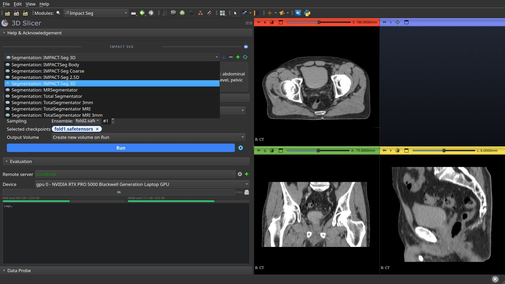
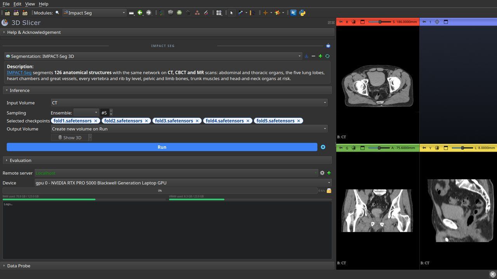
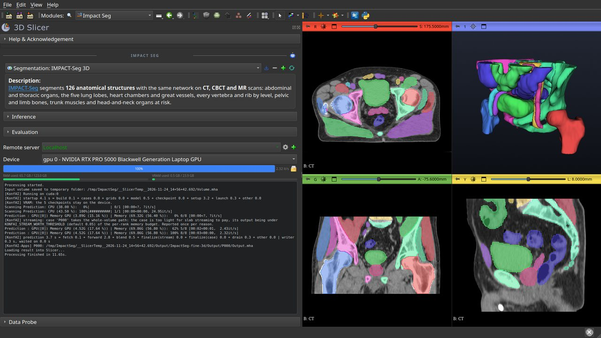
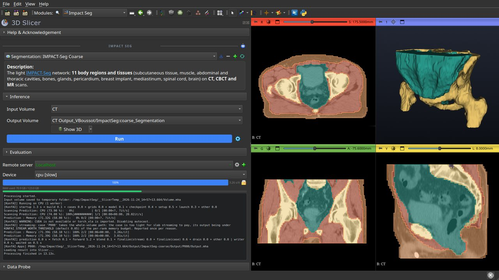
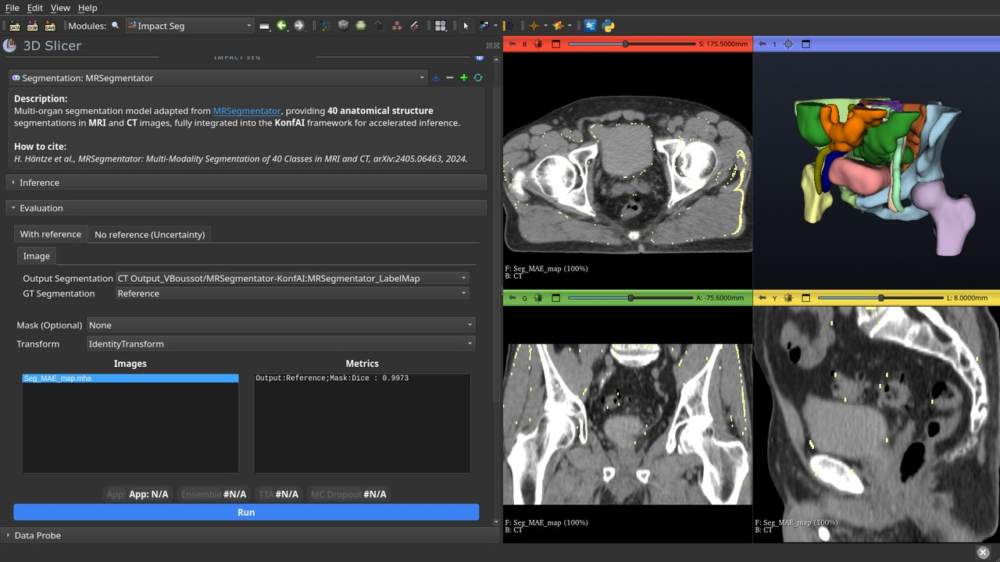
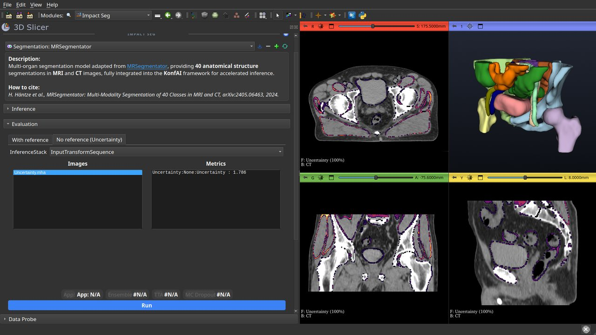

# Walkthrough

Recorded on a public pelvic CT of the [SynthRAD2023](https://synthrad2023.grand-challenge.org/) challenge
(1PC006, 407 × 277 × 105 voxels of 1 × 1 × 2 mm, from the
[konfai-demo](https://huggingface.co/datasets/VBoussot/konfai-demo) dataset), with its MRSegmentator
segmentation as the reference. Recorded on an RTX PRO 5000 (24 GB). A DICOM series loaded through the DICOM
module works the same way, and so do CBCT and MRI volumes.

1. **Install** the extension and open **Impact Seg** (category *Segmentation*). On the first opening the module
   installs `konfai-apps` into Slicer's Python; PyTorch comes from the SlicerPyTorch extension. Load the CT (drag
   and drop, or *Add Data*). The app list holds the three IMPACT-Seg apps (*3D*, *2.5D*, *Coarse*), the earlier
   *IMPACTSeg Body* model, MRSegmentator and the TotalSegmentator apps.

   

2. **Choose the model.** *Segmentation: IMPACT-Seg 3D* segments 126 structures; the card under the list
   describes it, click it for the full text. The **Ensemble** row picks among its five folds, here all five, whose
   predictions are averaged; one fold is about five times faster. The IMPACT-Seg apps have no test-time
   augmentation, since their labels are sided (left and right kidney, ribs). The **Device** row lists the CPU and
   the GPUs.

   

3. **Run.** The input is written to a temporary folder and `konfai-apps infer` runs in a separate process; the
   log, the progress bar and the RAM and VRAM gauges follow it. The result is loaded as a Segmentation node with
   the names and colours of the structures, over the CT. **Show 3D**, under *Output Volume*, renders it (here
   with the outer muscles hidden in 3D). The five folds took about 12 s on this card.

   

4. **A coarse map in seconds.** *Segmentation: IMPACT-Seg Coarse* gives 11 body regions and tissues
   (subcutaneous tissue, muscle, abdominal and thoracic cavities, bones, spinal cord, ...). It runs on the CPU, in
   about 15 s here.

   

5. **Evaluate against a reference.** Run *Segmentation: MRSegmentator* with its five folds and **Uncertainty**
   ticked (about 10 minutes on the CPU). Load the reference segmentation as a label map (*Add Data*, option
   *LabelMap*). Open *Evaluation*, tab *With reference*: *Output Segmentation* is the label map the run left in
   the scene (its name ends with `_LabelMap`), *GT Segmentation* is the reference. A mask and a transform are
   optional. Run. The *Metrics* list gives the Dice; click `Seg_MAE_map.mha` in the *Images* list to load the
   voxels where the two segmentations disagree (shown here over the CT).

   

6. **Estimate uncertainty without reference.** Tab *No reference (Uncertainty)*, for the apps that ship an
   uncertainty configuration, such as MRSegmentator: the inference stack written at step 5 is preselected. Run.
   The result is a voxel-wise variance map of the five sampled segmentations, non-zero where the folds disagree,
   and its mean as a metric.

   

From the command line, the same runs are:

```bash
konfai-apps infer HCedric/IMPACTSeg:fine-3d -i CT.mha -o Output --gpu 0
konfai-apps infer HCedric/IMPACTSeg:coarse -i CT.mha -o Output --cpu 1
konfai-apps infer VBoussot/MRSegmentator-KonfAI:MRSegmentator -i CT.mha -o Output --cpu 1 -uncertainty
konfai-apps eval VBoussot/MRSegmentator-KonfAI:MRSegmentator -i Segmentation.mha --gt Reference.mha -o Evaluation
konfai-apps uncertainty VBoussot/MRSegmentator-KonfAI:MRSegmentator -i InferenceStack.mha -o Uncertainty
```
